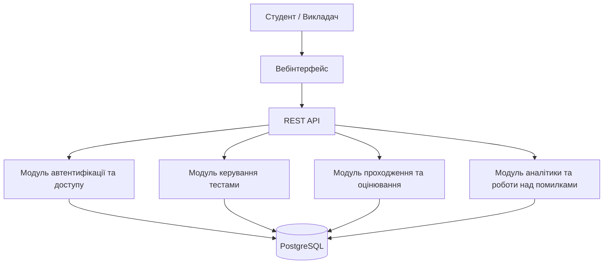
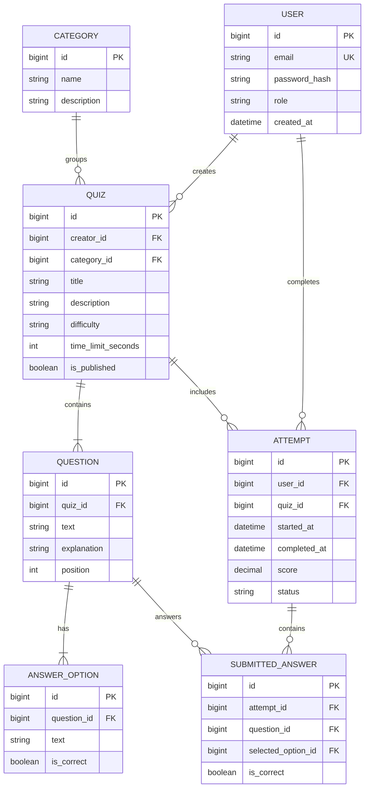
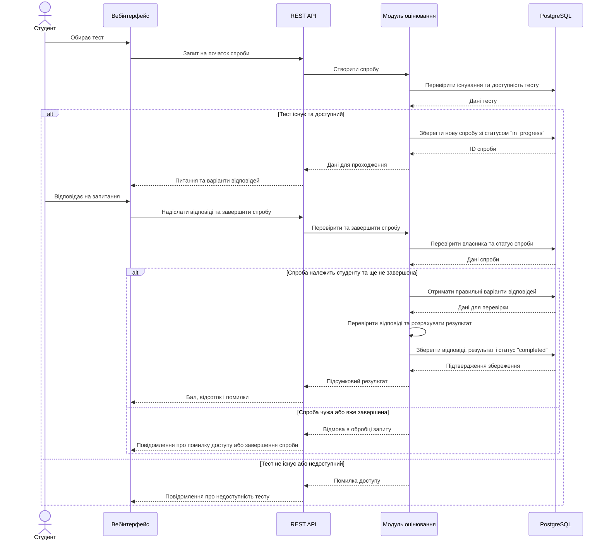
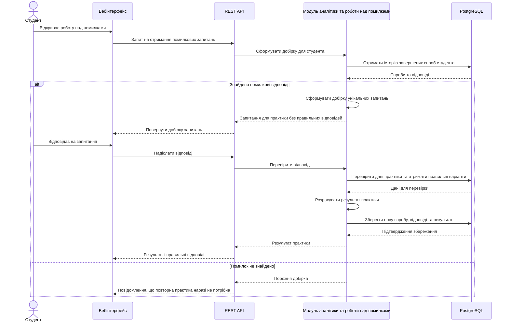

# SDD: Система онлайн-тестування (Quiz App)

## 1. Огляд і глосарій

Quiz App — вебзастосунок для інтерактивного тестування, оцінювання знань і персоналізованої
навчальної практики. Викладачі створюють тести з питаннями, варіантами відповідей,
категоріями та рівнями складності. Студенти проходять тести з обмеженням часу,
отримують результати й відстежують власний прогрес.
На відміну від звичайних систем онлайн-тестування, Quiz App аналізує результати
за категоріями, допомагає визначати слабкі теми та формує окремі тести на основі
попередніх помилок. Система також підтримує гейміфікацію: нарахування досвіду (XP),
досягнення та серії занять.
**Межі першої версії:** продукт зосереджений на створенні тестів, індивідуальному тестуванні, автоматичному оцінюванні, базовій аналітиці та практиці на основі попередніх помилок.

**Поза скоупом першої версії:** гейміфікація, рейтинг найкращих студентів, статистика за тематичними категоріями.

**Глосарій:**

| Термін                | Значення в цьому документі                                                               |
|-----------------------|------------------------------------------------------------------------------------------|
| Користувач            | Зареєстрована особа, яка працює із системою в ролі студента або викладача.               |
| Quiz                  | Набір запитань, об'єднаних спільною темою та призначених для перевірки знань.            |
| Запитання             | Окреме завдання в тесті, що містить текст і варіанти відповідей.                         |
| Спроба                | Одне проходження тесту конкретним студентом із зафіксованими відповідями та результатом. |
| Категорія             | Тематична група запитань                                                                 |
| Аналітика             | Статистика результатів користувача за тестами, категоріями та попередніми спробами.      |
| Робота над помилками  | Повторна практика із запитаннями, на які користувач раніше відповів неправильно.

## 2. Функціональні вимоги

> User stories строго у форматі: «Як **<роль>**, я хочу **<дія>**, щоб **<цінність>**».
> Усі три частини обов'язкові — без «щоб» історія не пояснює, навіщо її робити.
> Пріоритезуйте за MoSCoW: **Must** (без цього продукт не має сенсу), **Should**
> (важливо, але перший реліз виживе без цього), **Could** (приємний бонус),
> **Won't (this time)** — свідомо відкладене; цей рядок показує, що ви керуєте скоупом.
> Орієнтир: 6–12 історій, з них 3–5 Must.

| ID    | User story                                                                                                                                                             | Пріоритет |
|-------|------------------------------------------------------------------------------------------------------------------------------------------------------------------------|----------|
| US-1  | Як користувач, я хочу зареєструватися та увійти в систему, щоб отримати доступ до функцій відповідно до своєї ролі.                                                    | Must |
| US-2  | Як викладач, я хочу створювати, редагувати та видаляти тести із запитаннями, щоб організовувати перевірку знань студентів.                                             | Must |
| US-3  | Як студент, я хочу проходити доступні тести та надсилати відповіді, щоб перевіряти власні знання.                                                                      | Must |
| US-4  | Як студент, я хочу автоматично отримувати результат після завершення тесту, щоб одразу розуміти рівень засвоєння матеріалу.                                            | Must |
| US-5  | Як студент, я хочу переглядати історію своїх спроб, щоб відстежувати зміни результатів у часі.                                                                         | Should|
| US-6  | Як студент, я хочу переглядати статистику за категоріями, щоб визначати теми, які потребують додаткового опрацювання.                                                  | Should |
| US-7  | Як студент, я хочу повторно проходити практику на основі своїх неправильних відповідей, щоб закріплювати складний матеріал. | Should |
| US-8  | Як викладач, я хочу переглядати результати проходження створених мною тестів, щоб оцінювати успішність студентів.                                                       | Should |
| US-9  | Як викладач, я хочу задавати категорію та рівень складності запитань, щоб упорядковувати навчальні матеріали.                                                            | Could |
| US-10 | Як студент, я хочу бачити пояснення до відповідей, якщо викладач їх додав, щоб краще розуміти допущені помилки.                                                           | Could|

## 3. Нефункціональні вимоги

Наведені показники є цільовими критеріями приймання, які потрібно перевірити під час тестування системи.

| ID    | Категорія        | Вимога (з метрикою)                                                                                                                                                         |
|-------|------------------|-----------------------------------------------------------------------------------------------------------------------------------------------------------------------------|
| NFR-1 | Продуктивність   | Час відповіді API для типових операцій перегляду тестів і результатів має становити менше ніж 200 мс у 95% запитів за навантаження до 100 одночасних користувачів.          |
| NFR-2 | Масштабованість  | Система має підтримувати щонайменше 100 одночасних користувачів і зберігати не менше 1000 спроб проходження тестів.                                                         |
| NFR-3 | Доступність      | Uptime ≥ 99% на місяць (≈ до 7 години простою); планові роботи — вночі за Києвом і анонсуються за 24 години.                                                                |
| NFR-4 | Безпека          | Паролі мають зберігатися лише у вигляді криптографічних хешів; захищені операції повинні вимагати автентифікації та перевірки ролі користувача.                             |
| NFR-5 | Цілісність даних | Відповіді та результати завершених спроб мають зберігатися в базі даних. Повторне надсилання вже завершеної спроби не повинно призводити до повторного зарахування результату. |
| NFR-6 | Сумісність          | Вебінтерфейс має коректно працювати в актуальних версіях Google Chrome, Mozilla Firefox і Microsoft Edge.                                                                   |
| NFR-7 | Тестованість      | Основна бізнес-логіка оцінювання, проходження тестів і роботи над помилками має бути покрита автоматизованими тестами щонайменше на 80% рядків коду відповідних модулів.    |

## 4. Архітектура

Quiz App реалізується як вебзастосунок із клієнтським інтерфейсом,
REST API, набором серверних модулів і реляційною базою даних.
Для першої версії використовується модульний моноліт: основні
бізнес-модулі працюють у межах одного серверного застосунку,
але мають чітко розділені обов'язки.

**Компоненти:**

- **Вебінтерфейс** — забезпечує реєстрацію, вхід, створення тестів, проходження завдань і перегляд результатів.
- **REST API** — приймає запити клієнта, перевіряє вхідні дані та передає їх відповідним серверним модулям.
- **Модуль автентифікації та доступу** — відповідає за вхід користувачів, перевірку їхніх ролей і контроль доступу до ресурсів.
- **Модуль керування тестами** — реалізує створення, редагування, видалення та отримання тестів, запитань і категорій.
- **Модуль проходження та оцінювання** — створює спроби, зберігає відповіді, перевіряє їх і розраховує результати.
- **Модуль аналітики та роботи над помилками** — формує статистику, історію результатів і добірки запитань для повторної практики
- **PostgreSQL** — зберігає дані користувачів, тести, запитання, відповіді, спроби та результати.

## 5. Модель даних

Один викладач може створювати багато тестів, а кожен тест належить
одній категорії та містить декілька запитань. Кожне запитання має кілька варіантів відповіді, серед яких лише один є правильним.
Під час проходження тесту студент обирає один варіант відповіді
Кожна спроба належить одному користувачу та одному тесту й містить
надіслані відповіді. Поле status дає змогу розрізняти незавершені
та завершені спроби. Аналітика й практика на основі помилок формуються
за збереженими спробами та відповідями, тому окреме дублювання цих даних не потрібне.

## 6. Ключові сценарії

### 6.1. Проходження тесту та автоматичне оцінювання

Студент обирає доступний тест, відповідає на запитання та надсилає відповіді для автоматичної перевірки. Система перевіряє доступність тесту, зберігає спробу, перевіряє відповіді та розраховує результат. Завершену спробу не можна надіслати повторно для зміни результату.

### 6.2. Повторна практика на основі помилок

Студент запускає практику, щоб повторно опрацювати запитання, на які він раніше відповідав неправильно. Система формує добірку на основі історії спроб конкретного студента, перевіряє нові відповіді та зберігає результат практики.

## 7. Ескіз API

| Метод  | Шлях                          | Призначення                               | Доступ                  |
|--------|-------------------------------|-------------------------------------------|-------------------------|
| POST   | `/api/auth/register`          | Реєстрація користувача                    | Гість                   |
| POST   | `/api/auth/login`             | Вхід у систему                            | Гість                   |
| GET    | `/api/quizzes`                | Отримання списку доступних тестів         | Студент, викладач        |
| POST   | `/api/quizzes`                | Створення нового тесту                    | Викладач                 |
| PUT    | `/api/quizzes/{id}`           | Редагування тесту                         | Автор тесту              |
| DELETE | `/api/quizzes/{id}`           | Видалення тесту                           | Автор тесту              |
| POST   | `/api/quizzes/{id}/questions` | Додавання запитання до тесту              | Автор тесту              |
| POST   | `/api/quizzes/{id}/attempts`  | Початок проходження тесту                 | Студент                  |
| POST   | `/api/attempts/{id}/submit`   | Надсилання відповідей і завершення тесту  | Студент — власник спроби |
| GET    | `/api/attempts/{id}/result`   | Отримання результату тесту                | Студент — власник спроби |
| GET    | `/api/me/attempts`            | Перегляд історії власних спроб            | Студент                  |

## 8. Ризики та альтернативи

**Ризики:**

| **Ризик** | **Імовірність** | **Вплив** | **Як пом'якшуємо** |
|---|---|---|---|
| Втрата відповідей під час проходження тесту | Середня | Середній: студенту доведеться проходити тест повторно | Зберігати спроби та відповіді в базі даних і перевіряти коректність їх запису. |
| Несанкціонований доступ до тестів або результатів | Середня | Високий: розкриття даних користувачів або зміна чужих тестів | Перевіряти автентифікацію, роль користувача та право доступу до конкретного ресурсу на сервері. |
| Помилки під час створення або редагування тестів | Середня | Середній: тест може містити некоректні запитання або варіанти відповідей | Перевіряти обов'язкові поля, наявність варіантів відповідей і правильність введених даних перед збереженням. |
| Недостатня швидкість роботи застосунку | Низька | Середній: затримки під час перегляду тестів і результатів | Оптимізувати запити до бази даних і перевіряти час відповіді основних операцій. |
| Наявність сильних конкурентів | Висока | Середній: користувачі можуть обирати вже знайомі інструменти для створення тестів | Зосередитися на перевагах Quiz App|

**Розглянуті альтернативи:**

- **Зберігання результатів лише на клієнті замість бази даних:** відкинуто, оскільки користувач повинен мати змогу переглядати історію своїх спроб після повторного входу в систему.
- **Ручна перевірка відповідей замість автоматичного оцінювання:** відкинуто, оскільки автоматична перевірка дає змогу швидко отримувати результати та зменшує потребу в ручній роботі викладача.
- **Анонімне проходження тестів:** відкинуто, оскільки без авторизації складніше зберігати історію спроб і відстежувати індивідуальний навчальний прогрес користувачів.