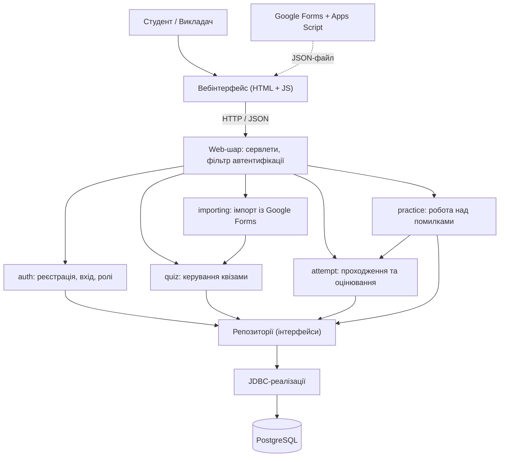
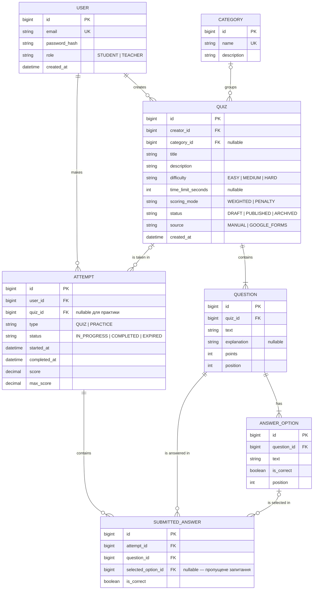
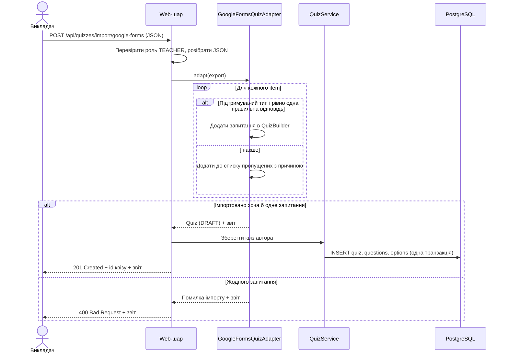
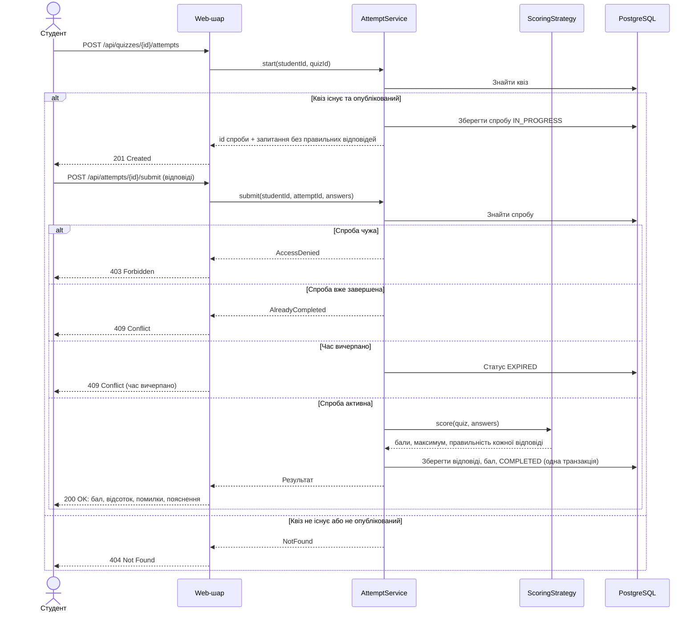
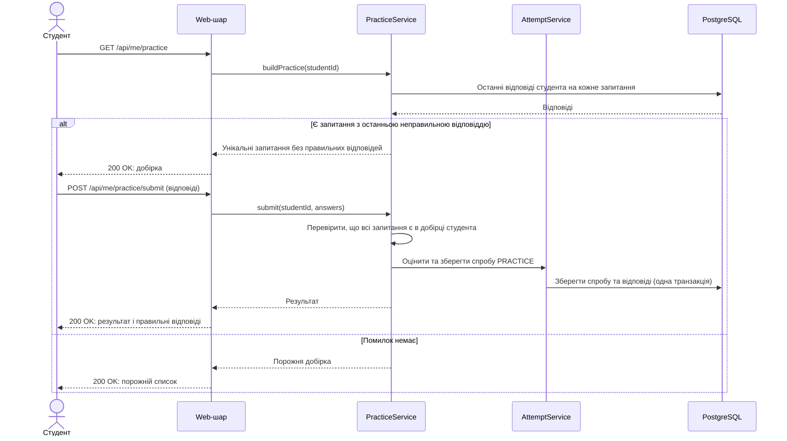

# SDD: Система онлайн-тестування (Quiz App)

## 1. Огляд і глосарій

Quiz App — вебзастосунок для тестування, автоматичного оцінювання знань і практики на основі власних помилок. Викладачі створюють квізи із запитаннями, варіантами відповідей, категорією та рівнем складності — вручну або імпортом із Google Forms. Студенти проходять опубліковані квізи, одразу отримують результат, переглядають історію спроб і повторно опрацьовують запитання, на які відповіли неправильно.

На відміну від звичайних форм для опитувань, Quiz App зберігає історію спроб кожного студента й автоматично формує практику з тих запитань, де студент помилився. Імпорт із Google Forms дає змогу не переписувати вручну тести, які викладач уже має.

**Межі першої версії (MVP):** створення та імпорт квізів, проходження з автоматичним оцінюванням, історія спроб, робота над помилками, результати для викладача, розмежування доступу за ролями.

**Поза скоупом першої версії:** гейміфікація (XP, досягнення, серії), рейтинг студентів, статистика за категоріями, імпорт через Google Forms API з OAuth, запитання з кількома правильними відповідями та відкриті запитання.

**Глосарій:**

| Термін | Значення в цьому документі |
|---|---|
| Користувач | Зареєстрована особа, яка працює із системою в ролі студента або викладача. |
| Квіз | Набір запитань зі спільною темою для перевірки знань (у коді — `Quiz`). Слово «тест» у документі вживається лише для автоматичних тестів коду. |
| Запитання | Окреме завдання квізу: текст, кількість балів і варіанти відповідей, з яких рівно один правильний. |
| Спроба | Одне проходження квізу або практики конкретним студентом із зафіксованими відповідями та результатом. |
| Категорія | Тематична група, до якої належить квіз. |
| Робота над помилками (практика) | Повторне проходження запитань, на які студент востаннє відповів неправильно. |
| Імпорт із Google Forms | Створення квізу з JSON-файлу, який експортує з Google Forms скрипт Google Apps Script. |

## 2. Функціональні вимоги

| ID | User story | Пріоритет |
|---|---|---|
| US-1 | Як користувач, я хочу зареєструватися та увійти в систему, щоб отримати доступ до функцій відповідно до своєї ролі. | Must |
| US-2 | Як викладач, я хочу створювати, редагувати, публікувати та видаляти квізи із запитаннями, щоб організовувати перевірку знань студентів. | Must |
| US-3 | Як студент, я хочу проходити опубліковані квізи та надсилати відповіді, щоб перевіряти власні знання. | Must |
| US-4 | Як студент, я хочу автоматично отримувати результат після завершення квізу, щоб одразу розуміти рівень засвоєння матеріалу. | Must |
| US-5 | Як викладач, я хочу імпортувати квіз із Google Forms, щоб не переносити вручну тести, які я вже створив. | Should |
| US-6 | Як студент, я хочу переглядати історію своїх спроб, щоб відстежувати зміни результатів у часі. | Should |
| US-7 | Як студент, я хочу проходити практику на запитаннях, на які раніше відповів неправильно, щоб закріплювати складний матеріал. | Should |
| US-8 | Як викладач, я хочу переглядати результати проходження створених мною квізів, щоб оцінювати успішність студентів. | Should |
| US-9 | Як викладач, я хочу задавати категорію та рівень складності квізу, щоб упорядковувати навчальні матеріали. | Could |
| US-10 | Як студент, я хочу бачити пояснення до відповідей, якщо викладач їх додав, щоб краще розуміти допущені помилки. | Could |
| US-11 | Як викладач, я хочу встановлювати обмеження часу на проходження квізу, щоб умови перевірки були однаковими для всіх студентів. | Could |
| US-12 | Як студент, я хочу бачити статистику за категоріями, щоб визначати теми, які потребують додаткового опрацювання. | Won't (this time) |
| US-13 | Як студент, я хочу отримувати XP і досягнення за регулярні заняття, щоб мати додаткову мотивацію. | Won't (this time) |

## 3. Нефункціональні вимоги

Наведені показники є цільовими критеріями приймання, які перевіряються під час фази тестування.

| ID | Категорія | Вимога (з метрикою) |
|---|---|---|
| NFR-1 | Продуктивність | Час відповіді API для перегляду квізів і результатів — менше 200 мс у 95% запитів за навантаження до 100 одночасних користувачів. |
| NFR-2 | Масштабованість | Система підтримує щонайменше 100 одночасних користувачів і зберігає не менше 10 000 спроб без погіршення NFR-1. |
| NFR-3 | Доступність | Uptime ≥ 99% на місяць (≈ 7 годин простою); планові роботи — вночі за київським часом з анонсом за 24 години. |
| NFR-4 | Безпека | Паролі зберігаються лише як хеші PBKDF2 із сіллю; захищені операції вимагають автентифікації та перевірки ролі; студент не отримує від API правильних відповідей до завершення спроби. |
| NFR-5 | Цілісність даних | Відповіді та результати завершених спроб зберігаються в базі в одній транзакції. Повторне надсилання завершеної спроби повертає помилку 409 і не змінює результат. |
| NFR-6 | Сумісність | Вебінтерфейс коректно працює в актуальних версіях Google Chrome, Mozilla Firefox і Microsoft Edge. |
| NFR-7 | Тестованість | Модулі оцінювання, проходження квізу, практики та імпорту розробляються за TDD і покриті автоматичними тестами щонайменше на 80% рядків (звіт JaCoCo). |

## 4. Архітектура

Quiz App — модульний моноліт на Java 21 без фреймворків рівня Spring. HTTP-запити приймають сервлети (Jakarta Servlet API, вбудований Apache Tomcat), бізнес-логіка живе в сервісах, доступ до даних — через інтерфейси репозиторіїв із реалізацією на чистому JDBC.



**Шари та правило залежностей:** `web → service → domain`, `service → repository (інтерфейс)`. Доменні класи не залежать ні від сервлетів, ні від JDBC. Завдяки цьому бізнес-логіку можна тестувати за TDD з in-memory реалізаціями репозиторіїв, без бази й сервера.

**Компоненти:**

- **Вебінтерфейс** — статичні HTML-сторінки та JavaScript, що звертаються до REST API.
- **Web-шар** — сервлети приймають запити, перетворюють JSON у DTO (Jackson), викликають сервіси й повертають JSON. Фільтр автентифікації перевіряє сесію (`HttpSession`) і роль користувача.
- **auth** — реєстрація, вхід, хешування паролів, перевірка ролей.
- **quiz** — створення, редагування, публікація, архівування квізів і запитань; валідація (рівно один правильний варіант).
- **importing** — перетворення JSON-експорту Google Forms на квіз; звіт про пропущені запитання.
- **attempt** — створення спроб, перевірка відповідей, розрахунок балів, захист від повторного надсилання.
- **practice** — пошук запитань з останньою неправильною відповіддю, формування та оцінювання практики.
- **PostgreSQL** — зберігає користувачів, категорії, квізи, запитання, спроби та відповіді.
  **Технології:**

| Призначення | Технологія |
|---|---|
| Мова, збирання | Java 21, Maven |
| HTTP | Jakarta Servlet API 6, вбудований Apache Tomcat 10.1 |
| JSON | Jackson Databind |
| База даних | PostgreSQL, JDBC-драйвер `org.postgresql` |
| Хешування паролів | PBKDF2WithHmacSHA256 (стандартна бібліотека JDK) |
| Тести | JUnit 5, AssertJ, JaCoCo |

**Структура пакетів:**

```
com.quizapp
├── domain        — Quiz, Question, AnswerOption, Attempt, User, ...
├── quiz          — QuizService, QuizBuilder, QuizRepository
├── attempt       — AttemptService, AttemptRepository
│   └── scoring   — ScoringStrategy та реалізації
├── practice      — PracticeService
├── importing
│   └── googleforms — GoogleFormExport (DTO), GoogleFormsQuizAdapter
├── auth          — AuthService, PasswordHasher, UserRepository
├── persistence   — JDBC-реалізації репозиторіїв, ConnectionFactory
└── web           — сервлети, фільтр, обробка помилок, Main
```

## 5. Патерни проєктування

| Група | Патерн | Де застосовано | Навіщо |
|---|---|---|---|
| Породжувальний | **Builder** | `QuizBuilder` | Квіз складається з багатьох частин (запитання, варіанти, категорія, обмеження часу). Builder збирає його покроково і в `build()` один раз перевіряє інваріанти: є хоча б одне запитання, у кожного запитання рівно один правильний варіант. Ним користуються і ручне створення, і імпорт. |
| Структурний | **Adapter** | `GoogleFormsQuizAdapter` | Формат Google Forms (items, choices, isCorrect, points) не збігається з моделлю Quiz App. Адаптер перетворює чужий формат на `Quiz`, тож решта системи нічого не знає про Google Forms. Імпорт через Google Forms API у майбутньому — це новий адаптер, без змін у сервісах. |
| Поведінковий | **Strategy** | `ScoringStrategy`: `WeightedScoring`, `PenaltyScoring` | Правила підрахунку балів залежать від квізу: звичайне (сума балів правильних відповідей) або зі штрафом за неправильну відповідь. `AttemptService` не містить `if` за типом оцінювання, а отримує стратегію відповідно до налаштування квізу. |

Додатково використовується архітектурний патерн **Repository** (інтерфейси доступу до даних з in-memory та JDBC-реалізаціями).

## 6. Модель даних



**Правила та обмеження:**

- Викладач створює багато квізів; квіз може належати одній категорії або не мати її.
- Кожне запитання має щонайменше два варіанти, з яких **рівно один** правильний. Це перевіряє `QuizBuilder` (у схемі БД таке правило не виразити простим обмеженням).
- Студенти бачать лише квізи зі статусом `PUBLISHED`. Квіз, який вже має спроби, не можна редагувати (щоб не спотворити історію), а видалення переводить його в `ARCHIVED`. Квіз без спроб видаляється повністю.
- Спроба типу `QUIZ` посилається на квіз; спроба типу `PRACTICE` має `quiz_id = NULL` і містить запитання з різних квізів.
- **Запитання вважається помилковим** для студента, якщо його **остання** завершена відповідь на це запитання неправильна. Після правильної відповіді в практиці чи повторній спробі запитання зникає з добірки.
- Обмеження часу: якщо відповіді надіслано пізніше ніж `started_at + time_limit_seconds + 30 с`, спроба отримує статус `EXPIRED`, а відповіді не зараховуються.
- `percent = score / max_score × 100` обчислюється під час читання і не зберігається.
- Аналітика й практика будуються зі збережених спроб і відповідей, тож окремо дані не дублюються.
## 7. Імпорт із Google Forms

**Як це працює:**

1. Викладач відкриває свою Google Form → «Розширення» → «Apps Script» і вставляє скрипт `tools/google-forms-export/Code.gs` з репозиторію.
2. Скрипт читає форму через `FormApp` і зберігає JSON-файл на Google Drive викладача.
3. Викладач завантажує JSON у Quiz App (`POST /api/quizzes/import/google-forms`).
4. `GoogleFormsQuizAdapter` перетворює JSON на квіз через `QuizBuilder`. Квіз створюється зі статусом `DRAFT`, щоб викладач перевірив його перед публікацією.
   **Формат експорту:**

```json
{
  "source": "google-forms",
  "formId": "1FAIpQL...",
  "title": "Основи Java",
  "description": "Контрольна з теми ООП",
  "isQuiz": true,
  "items": [
    {
      "type": "MULTIPLE_CHOICE",
      "title": "Який модифікатор робить поле видимим лише в класі?",
      "points": 2,
      "feedbackIncorrect": "Перегляньте тему інкапсуляції",
      "choices": [
        { "value": "public",  "isCorrect": false },
        { "value": "private", "isCorrect": true }
      ]
    }
  ]
}
```

**Відповідність полів:**

| Google Forms | Quiz App |
|---|---|
| `title`, `description` форми | `QUIZ.title`, `QUIZ.description` |
| `items[].title` | `QUESTION.text` |
| `items[].points` (0 або відсутнє → 1) | `QUESTION.points` |
| `items[].feedbackIncorrect` | `QUESTION.explanation` |
| `choices[].value`, `choices[].isCorrect` | `ANSWER_OPTION.text`, `ANSWER_OPTION.is_correct` |

**Що імпортується, а що пропускається:**

- `MULTIPLE_CHOICE` (радіокнопки) і `LIST` (випадний список) з рівно однією правильною відповіддю імпортуються.
- `CHECKBOX`, текстові відповіді, шкали, сітки, секції та зображення пропускаються.
- Запитання без позначеної правильної відповіді (форма не в режимі «Тест») пропускаються.
- Відповідь API містить звіт: скільки запитань імпортовано і які пропущено з причиною. Якщо не імпортовано жодного запитання, повертається 400 і квіз не створюється.


## 8. Ключові сценарії

### 8.1. Проходження квізу та автоматичне оцінювання

Студент починає спробу, отримує запитання без правильних відповідей, надсилає відповіді. Сервер перевіряє власника, статус і час спроби, оцінює відповіді через стратегію квізу та зберігає результат. Повторне надсилання завершеної спроби відхиляється.



### 8.2. Робота над помилками

Студент отримує добірку запитань, на які востаннє відповів неправильно, відповідає на них і отримує результат. Результат зберігається як спроба типу `PRACTICE`, тому правильно розв'язані запитання зникають з наступної добірки.



## 9. Ескіз API

Формат — JSON. Автентифікація — сесія (`HttpSession`, cookie `JSESSIONID`). Помилки повертаються як `{"error": "опис"}` з кодами 400 (некоректні дані), 401 (не автентифікований), 403 (немає прав), 404 (не знайдено), 409 (конфлікт стану).

**Автентифікація**

| Метод | Шлях | Призначення | Доступ |
|---|---|---|---|
| POST | `/api/auth/register` | Реєстрація. Роль `TEACHER` вимагає коду запрошення з конфігурації сервера | Гість |
| POST | `/api/auth/login` | Вхід | Гість |
| POST | `/api/auth/logout` | Вихід | Користувач |
| GET | `/api/me` | Поточний користувач | Користувач |

**Квізи та категорії**

| Метод | Шлях | Призначення | Доступ |
|---|---|---|---|
| GET | `/api/categories` | Список категорій | Користувач |
| POST | `/api/categories` | Створення категорії | Викладач |
| GET | `/api/quizzes` | Студент — опубліковані квізи; викладач — також свої чернетки | Користувач |
| GET | `/api/quizzes/{id}` | Квіз із запитаннями (правильні відповіді лише для автора) | Користувач |
| POST | `/api/quizzes` | Створення квізу | Викладач |
| PUT | `/api/quizzes/{id}` | Редагування (лише без спроб) | Автор квізу |
| POST | `/api/quizzes/{id}/publish` | Публікація | Автор квізу |
| DELETE | `/api/quizzes/{id}` | Видалення або архівування, якщо є спроби | Автор квізу |
| POST | `/api/quizzes/{id}/questions` | Додавання запитання | Автор квізу |
| PUT | `/api/questions/{id}` | Редагування запитання | Автор квізу |
| DELETE | `/api/questions/{id}` | Видалення запитання | Автор квізу |
| POST | `/api/quizzes/import/google-forms` | Імпорт із JSON-експорту Google Forms | Викладач |
| GET | `/api/quizzes/{id}/attempts` | Результати студентів за квізом | Автор квізу |

**Спроби та практика**

| Метод | Шлях | Призначення | Доступ |
|---|---|---|---|
| POST | `/api/quizzes/{id}/attempts` | Початок спроби | Студент |
| POST | `/api/attempts/{id}/submit` | Надсилання відповідей і завершення | Студент — власник спроби |
| GET | `/api/attempts/{id}/result` | Результат спроби | Власник спроби, автор квізу |
| GET | `/api/me/attempts` | Історія власних спроб | Студент |
| GET | `/api/me/practice` | Добірка для роботи над помилками | Студент |
| POST | `/api/me/practice/submit` | Надсилання відповідей практики | Студент |

## 10. Ризики та альтернативи

**Ризики:**

| Ризик | Імовірність | Вплив | Як пом'якшуємо |
|---|---|---|---|
| Несанкціонований доступ до квізів або чужих результатів | Середня | Високий: розкриття даних, зміна чужих квізів | Фільтр автентифікації; перевірка ролі та власника ресурсу в сервісах; автотести на 403 для чужих ресурсів. |
| Студент отримує правильні відповіді до завершення спроби | Середня | Високий: результати втрачають сенс | Окремі DTO для студента без `is_correct`; тест, що відповідь API їх не містить. |
| Подвійне зарахування результату через повторне надсилання | Середня | Середній: спотворена історія | Перевірка статусу спроби та оновлення в одній транзакції з умовою `status = 'IN_PROGRESS'`. |
| Формат Google Forms змінюється або містить непідтримувані типи запитань | Середня | Середній: імпорт частково не працює | Адаптер ізолює формат; непідтримувані запитання пропускаються зі звітом; тести на кожен тип item. |
| Некоректні дані квізу (немає правильної відповіді, порожні варіанти) | Середня | Середній: квіз неможливо пройти | Валідація в `QuizBuilder.build()`; квіз з імпорту створюється як чернетка. |
| Нестача часу перед контрольними точками | Висока | Високий: не всі функції готові до демонстрації | Пріоритезація MoSCoW: спершу Must-функції бекенду; вебінтерфейс — у другому спринті. |
| Сильні конкуренти (Google Forms, Moodle, Kahoot) | Висока | Низький для навчального проєкту | Фокус на відмінностях: імпорт із Google Forms і автоматична робота над помилками на основі історії. |

**Розглянуті альтернативи:**

- **Spring Boot замість сервлетів і JDBC:** відкинуто — мета проєкту полягає в тому, щоб самостійно побудувати шари та застосувати патерни, а не покладатися на фреймворк.
- **Google Forms API з OAuth замість експорту через Apps Script:** відкладено — потребує проєкту в Google Cloud і налаштування OAuth, що непропорційно складно для MVP. Завдяки Adapter його можна додати пізніше без змін у решті коду.
- **Зберігання результатів лише на клієнті:** відкинуто — історія має бути доступна після повторного входу, а результат не можна довіряти клієнту.
- **Ручна перевірка відповідей:** відкинуто — автоматичне оцінювання дає миттєвий результат і зменшує навантаження на викладача.
- **Анонімне проходження:** відкинуто — без облікового запису неможливо зберігати історію і формувати практику на помилках.
 