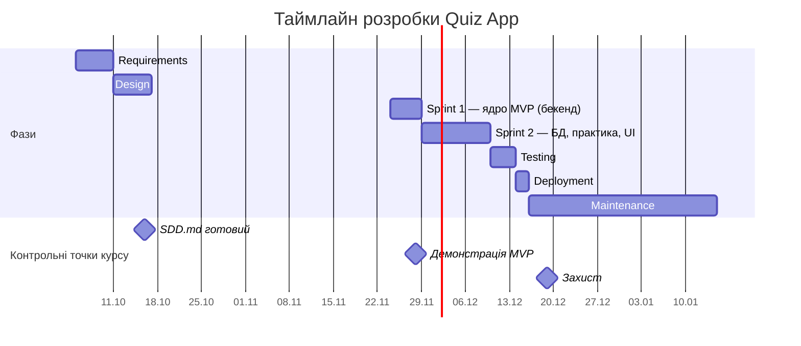

# SDLC: Система онлайн-тестування (Quiz App)

## 1. Ідея продукту

Quiz App — вебзастосунок для створення та проходження квізів з автоматичним оцінюванням результатів. Викладачі створюють квізи вручну або імпортують їх із Google Forms, додають запитання з варіантами відповідей, задають категорію та рівень складності. Студенти проходять доступні квізи, отримують результати, переглядають історію спроб і повторно опрацьовують запитання, на які раніше відповіли неправильно.

**Цільова аудиторія:** студенти, які хочуть перевіряти та закріплювати свої знання, і викладачі, яким потрібен простий інструмент для створення квізів та оцінювання результатів.

**Біль, який розв'язуємо:** створення квізів, перевірка відповідей і відстеження прогресу часто потребують ручної роботи або кількох різних інструментів. Багато викладачів уже мають тести в Google Forms, але переносити їх вручну довго. Quiz App імпортує такі тести, автоматизує оцінювання, зберігає історію спроб і допомагає студентам визначати запитання, які потребують повторного опрацювання.

## 2. Обрана методологія

**Методологія:** Scrum, адаптований для однієї людини.

**Чому саме вона для цього продукту:**

Quiz App розробляється як MVP, тому не всі деталі потрібно визначати до початку реалізації. Scrum дає змогу розділити роботу на короткі спринти: спочатку ядро (модель квізу, оцінювання, проходження, імпорт із Google Forms), потім збереження в базі, практика на помилках і вебінтерфейс. Після кожного спринту результат демонструється викладачу курсу, а наступні завдання коригуються.

**Адаптація під соло-розробку:** ролі Product Owner, Scrum Master і Development Team виконує одна людина. Product Backlog ведеться в GitHub Issues, Sprint Review — це демонстрація на контрольних точках курсу, ретроспектива — короткі нотатки «що спрацювало / що змінити» після кожного спринту.

**Практика розробки:** TDD (Test-Driven Development). Для бізнес-логіки спочатку пишеться тест, що падає (red), потім мінімальний код, щоб тест пройшов (green), потім рефакторинг. Цикл видно в історії комітів: `test: ...` → `feat: ...` → `refactor: ...`.

**Чому не інші:**

- **Waterfall:** передбачає послідовне проходження фаз і ускладнює зміни після проєктування. Для MVP, де вимоги уточнюються (наприклад, імпорт із Google Forms додано під час роботи), це незручно.
- **Kanban:** добре підходить для безперервного потоку завдань і підтримки, але для MVP з фіксованими контрольними точками курсу зручніше планувати роботу спринтами з чіткою метою.
## 3. Фази життєвого циклу

### 3.1. Requirements (Вимоги)

| | |
|---|---|
| **Вхідні артефакти** | Ідея Quiz App, опис цільової аудиторії та основних проблем користувачів, вимоги курсу. |
| **Дії** | Визначення ролей користувачів, формулювання user stories, пріоритезація за MoSCoW, визначення нефункціональних вимог і меж MVP. |
| **Вихідні артефакти** | Опис продукту, функціональні та нефункціональні вимоги в SDD, Product Backlog у GitHub Issues. |
| **Критерії виходу** | Визначені ролі студента й викладача; кожна user story має пріоритет; межі MVP (у скоупі / поза скоупом) зафіксовані й не суперечать одна одній. |

### 3.2. Design (Проєктування)

| | |
|---|---|
| **Вхідні артефакти** | Опис продукту, функціональні та нефункціональні вимоги. |
| **Дії** | Вибір архітектури (модульний моноліт, шари web → service → repository), проєктування моделі даних PostgreSQL, опис ключових сценаріїв у Mermaid, визначення REST API, формату імпорту з Google Forms, вибір патернів проєктування, аналіз ризиків та альтернатив. |
| **Вихідні артефакти** | SDD з архітектурою, моделлю даних, діаграмами сценаріїв, ескізом API, патернами та ризиками. |
| **Критерії виходу** | Сценарії проходження квізу, роботи над помилками та імпорту описані; модель даних підтримує всі функції MVP; патерни трьох груп (породжувальний, структурний, поведінковий) обрані й обґрунтовані. |

### 3.3. Implementation (Розробка)

| | |
|---|---|
| **Вхідні артефакти** | SDD, модель даних, ескіз API, Sprint Backlog. |
| **Дії** | Реалізація за TDD: доменна модель, оцінювання, проходження квізу, імпорт із Google Forms, практика на помилках, автентифікація, REST API на сервлетах, збереження в PostgreSQL через JDBC. Невеликі коміти з осмисленими повідомленнями. |
| **Вихідні артефакти** | Код застосунку (Java 21, Maven), SQL-схема бази даних, REST API, автоматичні тести, скрипт експорту з Google Forms. |
| **Критерії виходу** | Must-функції реалізовані; `mvn test` проходить; дані зберігаються в базі; результати обчислюються автоматично; TDD-цикл видно в історії комітів. |

### 3.4. Testing (Тестування)

| | |
|---|---|
| **Вхідні артефакти** | Реалізований MVP, функціональні та нефункціональні вимоги, автоматичні тести. |
| **Дії** | Перевірка покриття тестами (JaCoCo, ціль ≥ 80% для модулів оцінювання, проходження та практики). Ручна перевірка сценаріїв через HTTP-запити: реєстрація, створення та імпорт квізу, проходження, історія, робота над помилками. Перевірка прав доступу, некоректних даних, повторного надсилання завершеної спроби, імпорту форм із непідтримуваними типами запитань. Перевірка вебінтерфейсу в Chrome, Firefox, Edge. |
| **Вихідні артефакти** | Звіт JaCoCo, список виявлених помилок (GitHub Issues), виправлений код. |
| **Критерії виходу** | Усі основні сценарії перевірені; критичних помилок немає; доступ до чужих спроб і квізів обмежений; повторне надсилання не змінює результат. |

### 3.5. Deployment (Розгортання)

| | |
|---|---|
| **Вхідні артефакти** | Протестований MVP, код застосунку, SQL-схема, конфігурація. |
| **Дії** | Створення бази PostgreSQL і застосування схеми, налаштування змінних середовища (підключення до БД, код запрошення викладача), збирання застосунку командою `mvn package`, запуск і перевірка основних сценаріїв після запуску. |
| **Вихідні артефакти** | Запущена версія Quiz App, налаштована база даних, інструкція з запуску в `README.md`. |
| **Критерії виходу** | Застосунок запускається за інструкцією з README на чистій машині з Java 21 і PostgreSQL; користувач може увійти, пройти квіз і переглянути результат. |

### 3.6. Maintenance (Підтримка)

| | |
|---|---|
| **Вхідні артефакти** | Запущена версія Quiz App, вихідний код, результати тестування, відгуки користувачів. |
| **Дії** | Виправлення помилок (спочатку тест, що відтворює помилку), оновлення залежностей, покращення інтерфейсу, планування функцій зі списку Won't/Could. |
| **Вихідні артефакти** | Виправлення та оновлення, оновлена документація, оновлений Product Backlog. |
| **Критерії виходу** | Підтримка безперервна; для кожної помилки є issue і тест, що її відтворює; виправлення перевіряються перед публікацією. |

## 4. Definition of Done для продукту

- [ ] Користувач може зареєструватися та увійти в систему; паролі зберігаються лише як хеші.
- [ ] Викладач може створити, відредагувати, опублікувати та видалити (архівувати) квіз із запитаннями й варіантами відповідей.
- [ ] Викладач може імпортувати квіз із Google Forms через JSON-експорт і отримує звіт про імпортовані та пропущені запитання.
- [ ] Студент може пройти опублікований квіз і отримати автоматично розрахований результат.
- [ ] Завершені спроби та результати зберігаються в PostgreSQL і доступні після повторного входу.
- [ ] Студент може переглянути історію спроб і пройти практику на запитаннях, на які відповів неправильно.
- [ ] Сервер перевіряє права доступу до квізів і спроб; повторне надсилання завершеної спроби не змінює результат.
- [ ] Бізнес-логіка розроблена за TDD; покриття модулів оцінювання, проходження та практики ≥ 80%.
- [ ] У коді застосовано щонайменше три патерни з різних груп (Builder, Adapter, Strategy).
- [ ] Критичних помилок немає; `README.md` містить інструкцію з запуску.
- [ ] SDLC.md і SDD.md актуалізовані відповідно до того, що реально збудовано.
## 5. Таймлайн

**Sprint 1 (24.11–28.11), мета — працюючий бекенд MVP:** доменна модель, оцінювання, проходження квізу, імпорт із Google Forms, практика на помилках, автентифікація, REST API, збереження в PostgreSQL.
**Sprint 2 (29.11–09.12):** результати для викладача, вебінтерфейс, доопрацювання за відгуками з демонстрації.
**Testing і Deployment (10.12–15.12):** перевірка всього MVP, покриття, виправлення помилок, інструкція з запуску.
Підтримка триває після захисту.

## 6. Ролі та комунікація

### Команда

| Роль | Зона відповідальності |
|---|---|
| Розробник (я) | Проєктування архітектури, реалізація серверної та клієнтської частин, робота з базою даних. |
| Тестувальник (я) | Написання автоматичних тестів за TDD, ручна перевірка сценаріїв, фіксація та виправлення помилок. |
| Користувачі для зворотного зв'язку | Студенти та викладачі університету: перевіряють зручність сценаріїв, повідомляють про проблеми та пропозиції. |

Проєкт розробляється самостійно в межах навчального курсу, тому всі ролі команди виконує одна людина.

### Комунікація

- **Планування спринту:** на початку спринту з Product Backlog обираються завдання та мета спринту.
- **Перевірка прогресу:** демонстрація на контрольних точках курсу (Sprint Review) і короткі нотатки-ретроспективи.
- **Завдання та помилки:** GitHub Issues.
- **Код і документація:** GitHub; невеликі коміти у форматі `type: опис` (`test`, `feat`, `refactor`, `fix`, `docs`, `chore`); актуальні рішення відображаються в `docs/SDD.md` та `docs/SDLC.md`.
 