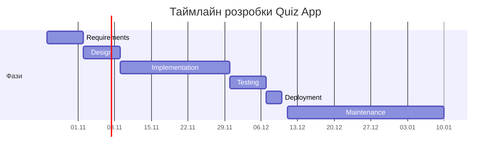

# SDLC: Система онлайн-тестування (Quiz App)

## 1. Ідея продукту

Quiz App — вебзастосунок для створення та проходження тестів з автоматичним оцінюванням результатів. Викладачі можуть створювати тести, додавати запитання з варіантами відповідей, задавати категорії та рівні складності. Студенти проходять доступні тести, отримують результати, переглядають історію спроб і можуть повторно опрацьовувати запитання, на які раніше відповіли неправильно.

**Цільова аудиторія:** студенти, які хочуть перевіряти та закріплювати свої знання, і викладачі, яким потрібен простий інструмент для створення тестів та оцінювання результатів.

**Біль, який розв'язуємо:** створення тестів, перевірка відповідей і відстеження прогресу часто потребують ручної роботи або використання кількох різних інструментів. Quiz App автоматизує оцінювання, зберігає історію спроб і допомагає студентам визначати запитання, які потребують повторного опрацювання.

## 2. Обрана методологія

**Методологія:** Scrum

**Чому саме вона для цього продукту:**

Quiz App розробляється як MVP, тому не всі деталі інтерфейсу та взаємодії користувачів потрібно визначати до початку реалізації. Scrum дає змогу розділити роботу на короткі ітерації: спочатку реалізувати реєстрацію та створення тестів, потім проходження тестування, а далі — історію результатів і практику на основі помилок. Після кожного етапу можна перевірити реалізовані функції та скоригувати наступні завдання.

**Чому не інші:**

- **Waterfall:** менш зручний для цього проєкту, оскільки передбачає послідовне проходження фаз і ускладнює внесення змін після завершення проєктування.
- **Kanban:** підходить для безперервного потоку завдань і підтримки, але для початкової розробки MVP з визначеним набором функцій зручніше планувати роботу короткими ітераціями Scrum.

## 3. Фази життєвого циклу

### 3.1. Requirements (Вимоги)

| | |
|---|---|
| **Вхідні артефакти** | Ідея Quiz App, опис цільової аудиторії та основних проблем користувачів. |
| **Дії** | Визначення ролей користувачів, формулювання user stories, пріоритезація функцій за MSCW, визначення нефункціональних вимог і меж MVP. |
| **Вихідні артефакти** | Опис продукту, функціональні та нефункціональні вимоги в SDD, початковий список завдань. |
| **Критерії виходу** | Визначені ролі студента й викладача; усі основні user stories мають пріоритет; вимоги до першої версії узгоджені між собою. |

### 3.2. Design (Проєктування)

| | |
|---|---|
| **Вхідні артефакти** | Опис продукту, функціональні та нефункціональні вимоги. |
| **Дії** | Вибір архітектури модульного моноліту, проєктування моделі даних PostgreSQL, опис ключових сценаріїв у Mermaid, визначення основних API-маршрутів, аналіз ризиків та альтернатив. |
| **Вихідні артефакти** | SDD із архітектурою, моделлю даних, діаграмами сценаріїв, ескізом API та ризиками. |
| **Критерії виходу** | Основні сценарії проходження тесту й роботи над помилками описані; модель даних підтримує заплановані функції; архітектура відповідає межам MVP. |

### 3.3. Implementation (Розробка)

| |                                                                                                                                                                                                                                               |
|---|-----------------------------------------------------------------------------------------------------------------------------------------------------------------------------------------------------------------------------------------------|
| **Вхідні артефакти** | SDD, модель даних, ескіз API та список пріоритетних завдань.                                                                                                                                                                                  |
| **Дії** | Реалізація реєстрації та входу; створення, редагування й видалення тестів; реалізація проходження тестів, автоматичного оцінювання, збереження спроб та практики на основі помилок. Написання автоматичних тестів для основної бізнес-логіки. |
| **Вихідні артефакти** | Код вебзастосунку, структура бази даних, реалізовані API-маршрути, автоматичні тести.                                                                                                                                                         |
| **Критерії виходу** | Основні функції MVP реалізовані; дані зберігаються в базі; результати квізів обчислюються автоматично; основні сценарії проходять перевірку розробника.                                                                                       |

### 3.4. Testing (Тестування)

| | |
|---|---|
| **Вхідні артефакти** | Реалізований MVP, функціональні вимоги, модель даних та автоматичні тести. |
| **Дії** | Перевірка реєстрації, створення тестів, проходження тестування, розрахунку результатів, історії спроб і роботи над помилками. Перевірка прав доступу, некоректних даних і повторного надсилання завершеної спроби. Перевірка вебінтерфейсу в актуальних браузерах. |
| **Вихідні артефакти** | Результати тестування, список виявлених помилок, виправлений код. |
| **Критерії виходу** | Усі основні сценарії перевірені; критичних помилок не залишилося; результати зберігаються коректно; доступ до чужих спроб обмежений. |

### 3.5. Deployment (Розгортання)

| | |
|---|---|
| **Вхідні артефакти** | Протестований MVP, код застосунку, конфігурація середовища та налаштування бази даних. |
| **Дії** | Налаштування середовища розгортання, підключення бази даних, конфігурація змінних середовища, запуск застосунку та перевірка основних функцій після розгортання. |
| **Вихідні артефакти** | Розгорнута версія Quiz App, налаштована база даних, інструкція із запуску. |
| **Критерії виходу** | Застосунок доступний у цільовому середовищі; користувач може увійти, пройти тест і переглянути результат; з'єднання з базою даних працює. |

### 3.6. Maintenance (Підтримка)

| | |
|---|---|
| **Вхідні артефакти** | Розгорнута версія Quiz App, вихідний код, результати тестування та відгуки користувачів. |
| **Дії** | Виправлення помилок, перевірка роботи застосунку, оновлення залежностей, покращення інтерфейсу та планування нових функцій на основі відгуків. |
| **Вихідні артефакти** | Виправлення та оновлення застосунку, оновлена документація, список майбутніх покращень. |
| **Критерії виходу** | Підтримка є безперервною; для кожної виявленої помилки створено завдання, а виправлення перевіряються перед публікацією. |

## 4. Definition of Done для продукту

- [ ] Користувач може зареєструватися та увійти в систему.
- [ ] Викладач може створити, відредагувати та видалити тест із запитаннями й варіантами відповідей.
- [ ] Студент може пройти доступний тест і отримати автоматично розрахований результат.
- [ ] Завершені спроби та результати зберігаються в базі даних і доступні після повторного входу.
- [ ] Студент може переглянути історію спроб і повторно опрацювати запитання, на які відповів неправильно.
- [ ] Сервер перевіряє права доступу до тестів і спроб; повторне надсилання завершеної спроби не змінює результат.
- [ ] Основні сценарії перевірені автоматичними або ручними тестами; критичних помилок не залишилося.
- [ ] SDLC.md і SDD.md актуалізовані відповідно до того, що реально збудовано.

## 5. Таймлайн

Таймлайн розрахований приблизно на шість тижнів до розгортання першої версії
за умови регулярної роботи над проєктом. Під час реалізації автоматичні
тести пишуться паралельно з кодом, а окрема фаза тестування призначена
для перевірки всього MVP і виправлення помилок. Підтримка триває після
першого релізу.

## 6. Ролі та комунікація

### Команда

| Роль | Зона відповідальності |
|---|---|
| Розробник (я) | Проєктування архітектури, реалізація клієнтської та серверної частин, робота з базою даних. |
| Тестувальник (я) | Перевірка основних сценаріїв, написання автоматичних тестів, виявлення та виправлення помилок. |
| Користувачі для зворотного зв'язку | Перевірка зручності сценаріїв студента й викладача, повідомлення про проблеми та пропозиції. |

Проєкт розробляється самостійно в межах навчального проєкту. Тому все на світі роблю - я. А користувачі звісно ж цільова аудиторія, тобто студентікі нашого чудового університету.

### Комунікація

- **Планування:** на початку кожної ітерації визначаються завдання та їхні пріоритети.
- **Перевірка прогресу:** після завершення основних функцій проводиться самоперевірка реалізації.
- **Завдання та помилки:** фіксуються в GitHub Issues або у списку завдань проєкту.
- **Код і документація:** зберігаються в GitHub; зміни відстежуються за допомогою комітів, а актуальні рішення відображаються у файлах `SDD.md` та `SDLC.md`.
